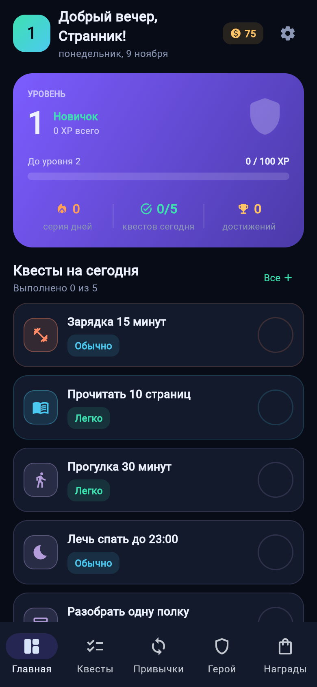
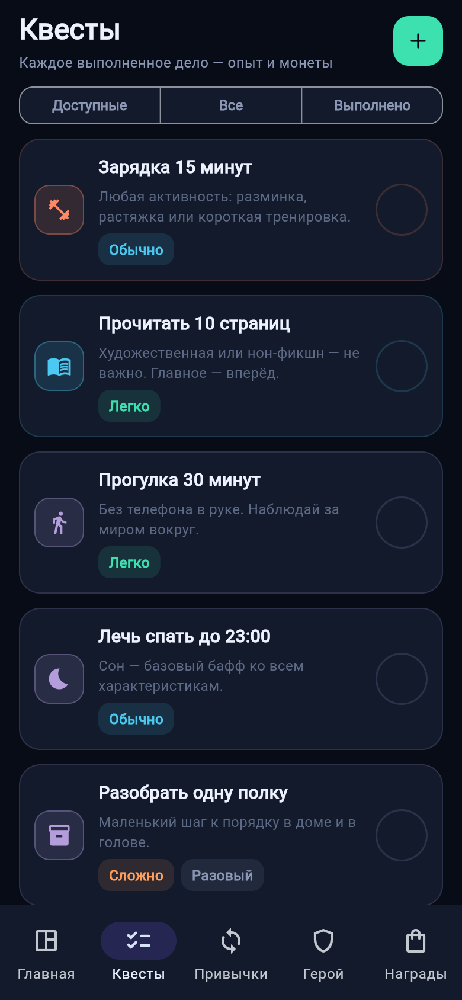
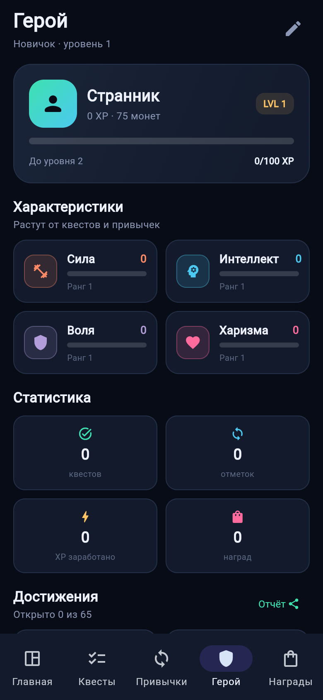

<p align="center">
  
</p>

<h1 align="center">IRL Quests</h1>

<p align="center">
  <b>Преврати обычную жизнь в RPG.</b><br>
  Квесты, привычки, опыт, монеты, достижения и реальные награды — локально, без аккаунтов и подписок.
</p>

<p align="center">
  <a href="https://github.com/Lstrzz/IRL-Quests/releases/latest"></a>
  
  
  
  <a href="https://github.com/Lstrzz/IRL-Quests/stargazers"></a>
</p>

<p align="center">
  <a href="https://lstrzz.github.io/IRL-Quests/"><b>Сайт проекта</b></a> ·
  <a href="https://github.com/Lstrzz/IRL-Quests/releases/latest"><b>Скачать</b></a> ·
  <a href="#сборка"><b>Сборка</b></a>
</p>

---

## Что это

IRL Quests — открытое приложение для геймификации повседневности. Выполняйте
квесты, отмечайте привычки, получайте опыт и монеты, прокачивайте героя,
открывайте достижения и тратьте заработанное на реальные награды.

Всё хранится в JSON на устройстве: без регистрации, облака и рекламы.

<p align="center">
  
  
  
</p>

## Возможности

**Квесты.** Ежедневные, еженедельные и разовые задачи четырёх уровней сложности.
Награды начисляются автоматически, незакрытые дела дня видны на главной.

**Привычки и серии.** Позитивные и негативные привычки, отметки раз в день,
streak, личные рекорды и бонусный опыт за длинную серию. День получает
коэффициент бонуса или штрафа.

**Прокачка героя.** Уровни, звания, шкала опыта и четыре характеристики:
сила, интеллект, воля и харизма.

**65 достижений.** За квесты, привычки, серии, уровни, характеристики, опыт,
награды и планирование. Открываются автоматически.

**Магазин и инвентарь.** Покупка наград за монеты с выбором количества,
хранение в инвентаре и использование с подтверждением.

**Отчёт героя.** Уровень, статистика, характеристики и достижения можно
сохранить картинкой PNG.

**Статистика и хроника.** Сколько сделано, заработано и что происходило
в последнее время.

**Живая эмблема серии.** Щит разгорается к 30 дням, затем месяц растёт огонёк,
а дальше он плавно меняет цвет каждый месяц.

**Локальность.** Атомарная запись, резервная копия, восстановление после
повреждённого файла, экспорт и импорт JSON.

## Скачать

| Платформа | Файл | Как установить |
|---|---|---|
| **Windows** | [IRL_Quests_Setup_1.2.exe](https://github.com/Lstrzz/IRL-Quests/releases/latest/download/IRL_Quests_Setup_1.2.exe) | Запустить установщик. Права администратора не нужны. |
| **Android** | [irl-quests.apk](https://github.com/Lstrzz/IRL-Quests/releases/latest/download/irl-quests.apk) | Открыть APK на телефоне или `adb install -r irl-quests.apk`. |
| **Docker (web)** | [irl-quests-web-1.2.tar](https://github.com/Lstrzz/IRL-Quests/releases/latest/download/irl-quests-web-1.2.tar) | `docker load -i irl-quests-web-1.2.tar`, затем `docker compose up -d`. |

Все сборки и контрольные суммы — на странице
[релизов](https://github.com/Lstrzz/IRL-Quests/releases/latest).

### Docker

```bash
docker load -i irl-quests-web-1.2.tar
docker compose -f docker-compose.deploy.yml up -d
# http://localhost:8080
```

## Запуск из исходников

Нужен Python **3.12–3.14** и [Flet](https://flet.dev).

```bash
python -m venv .venv
source .venv/bin/activate        # Windows: .venv\Scripts\activate
pip install "flet[all]==1.0.5"
flet run src/main.py             # окно
flet run --web src/main.py       # браузер
```

Тесты (76 штук: правила, хранилище, связи UI, ассеты):

```bash
pip install -e ".[dev]"
pytest -q
```

## Сборка

### Что нужно

| Компонент | Версия / примечание |
|---|---|
| Python | 3.12–3.14 |
| Flet | 1.0.5 |
| JDK | 17 |
| Android SDK | платформа 36, build-tools 36.0.0, NDK 28.2.13676358 |
| Flutter | Flet скачивает сам (3.44.8) |
| Inno Setup | 6 — для установщика Windows |
| git | в `PATH` — Flutter определяет им версию движка |

### Android и Web

```bash
pip install "flet[all]==1.0.5"
flet build apk -v -o release/android   # release/android/irl-quests.apk
flet build aab -o release/android      # Google Play
flet build web -o release/web          # статический веб-билд
adb install -r release/android/irl-quests.apk
```

Если на Windows не включён «Режим разработчика», Flutter не может создать
симлинки для плагинов. Перед сборкой APK отключите desktop-платформы:

```powershell
flutter config --no-enable-windows-desktop `
  --no-enable-linux-desktop --no-enable-macos-desktop
```

Параметры приложения (`org`, `product`, `build_number`, splash, иконка) заданы
в `[tool.flet]` внутри `pyproject.toml`.

### Windows: exe и установщик

```powershell
# папка с _internal — быстрый запуск
pyinstaller --noconfirm --clean --windowed --name IRL_Quests `
  --icon src\assets\icon.ico --add-data "src\assets\icon.ico;assets" `
  --distpath release\windows --workpath build\pyi --specpath build `
  --paths src src\main.py

# установщик Inno Setup для release\windows\IRL_Quests
& "$env:LOCALAPPDATA\Programs\Inno Setup 6\ISCC.exe" installer\IRL_Quests.iss
```

Установщик ставит приложение в `%LOCALAPPDATA%\Programs\IRL Quests` без прав
администратора, создаёт ярлыки в меню «Пуск» и на рабочем столе.

Иконки `src/assets/icon.png` (1024×1024) и `favicon.png` (128×128) можно
нормализовать скриптом:

```powershell
.venv\Scripts\python.exe tools\normalize_assets.py
```

Скрипт сохраняет оригиналы в `assets_backup/` и не перерисовывает изображение.

## Как устроено

```
src/main.py
    └── IRLApp(page)                 контроллер и навигация
            ├── Storage                JSON-хранилище
            ├── GameState              модели данных
            ├── engine                 игровые правила
            └── ui/views/*             пять экранов на Flet
```

| Путь | Роль |
|---|---|
| `src/main.py` | точка входа, `ft.run(main)` |
| `src/app/models.py` | сущности, справочники, стартовый контент |
| `src/app/engine.py` | правила, достижения, события |
| `src/app/storage.py` | JSON-хранилище, бэкапы, импорт/экспорт |
| `src/app/ui/app.py` | контроллер: вкладки, диалоги, действия |
| `src/app/ui/theme.py` | палитра и визуальные примитивы |
| `src/app/ui/components.py` | карточки, пустые состояния, выбор иконки |
| `src/app/ui/views/` | экраны: главная, квесты, привычки, герой, награды |
| `src/app/ui/report.py` | отчёт героя в PNG |
| `tests/` | 76 тестов: правила, хранилище, UI-wiring, ассеты |
| `docs/` | лендинг для GitHub Pages |
| `tools/` | нормализация и генерация иконок |

Логика (`models`, `engine`, `storage`) не импортирует Flet, поэтому её можно
тестировать отдельно от интерфейса. Все изменения состояния проходят через
`engine.*`, после чего контроллер сохраняет файл и перестраивает экран.

### Добавить достижение

1. Добавьте `Achievement(id, title, description, icon)` в `default_state()`.
2. Добавьте условие с тем же `id` в `engine.ACHIEVEMENT_CHECKS`.
3. Старые сохранения получат достижение при следующей загрузке.

### Изменить баланс

- награды за сложность — `DIFFICULTIES` и `Quest.coins` в `models.py`;
- бонус за уровень — `25 · уровень` в `engine._add_xp`;
- формулы привычек — `engine.check_in_habit`;
- после правок обновите таблицы в README и тесты.

## Игровые правила

### Квесты

| Сложность | XP | Монеты | Очки характеристики |
|---|---|---|---|
| Легко | 15 | 7 | +1 |
| Обычно | 30 | 15 | +2 |
| Сложно | 60 | 30 | +3 |
| Эпично | 120 | 60 | +4 |

Монеты за квест — `max(1, XP // 2)`. Ежедневный квест снова доступен после
полуночи, еженедельный — с понедельника, разовый исчезает после выполнения.
Сбросов по таймеру нет: доступность вычисляется из дат при каждом запуске.

### Опыт и уровни

Суммарный опыт для уровня `L`:

```
XP(L) = 100 · (L−1) · L / 2
```

| Уровни | 1–10 | 11–20 | 21–30 | 31–40 | 41–50 | 51–60 | 61–70 | 71–80 | 81–90 | 91–100 |
|---|---|---|---|---|---|---|---|---|---|---|
| Звание | Новичок | Ученик | Искатель | Практик | Адепт | Ветеран | Мастер | Герой | Хранитель | Легенда |

За новый уровень начисляется бонус `25 · уровень` монет — один раз за действие.

### Привычки

| Сложность | Базовый XP |
|---|---|
| Легко | 10 |
| Обычно | 15 |
| Сложно | 25 |
| Эпично | 40 |

```
бонус = 2 · min(серия, 10)
XP    = базовый XP + бонус
монеты = max(1, XP // 3) + серия // 3
```

Отмечать привычку можно раз в день. Если прошлый раз был вчера, серия растёт,
иначе начинается заново. Позитивная привычка даёт +1 к своей характеристике;
негативная отмечается как срыв — без XP, монет и очков характеристики.

**Коэффициент дня.** Отметки привычек меняют заработок XP и монет в этот день:

| Сложность | Позитивная | Негативная |
|---|---|---|
| Легко | +5% | −5% |
| Обычно | +10% | −10% |
| Сложно | +20% | −20% |
| Эпично | +30% | −30% |

Итог ограничен диапазоном `0.5…2.0` и умножает только новый заработок; цены
наград не меняются.

### Достижения

Всего 65 достижений: за квесты, привычки, серии, уровни, характеристики,
опыт, награды, инвентарь и планирование. Проверка запускается после каждого
действия, уже открытые не дублируются.

## Где хранятся данные

| Платформа | Путь |
|---|---|
| Android | каталог `FLET_APP_STORAGE_DATA`, файл `save.json` |
| Компьютер | `~/.irl_quests/save.json` |
| Свой каталог | переменная `IRL_QUESTS_DATA_DIR` |

Рядом лежат `save.bak.json` (предыдущая версия) и `save.broken.json`
(нечитаемый файл). Запись атомарная: временный файл, `fsync`, замена
`os.replace`, поэтому сбой не оставляет полузаписанный прогресс. Если
`save.json` повреждён, приложение сохраняет его копию и запускается с чистым
состоянием, не падая.

Формат — обычный JSON с отступами: его можно читать и править вручную.
Неизвестные поля игнорируются, отсутствующие получают значения по умолчанию,
поэтому старые сохранения совместимы. Экспорт и импорт доступны в настройках:
импорт принимает файл до 5 МБ, проверяет JSON и заменяет прогресс только после
подтверждения.

## Участие

Идеи, баги и предложения — в [issues](https://github.com/Lstrzz/IRL-Quests/issues).
Форк, ветка, pull request — приветствуется.

<p align="center">
  <sub>Сделано на Python + Flet. Данные остаются у вас.</sub>
</p>
